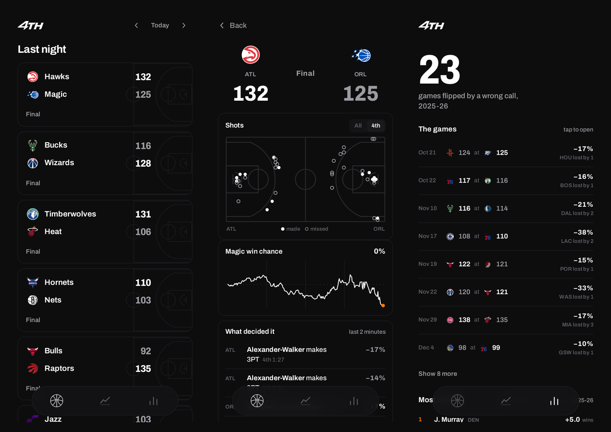
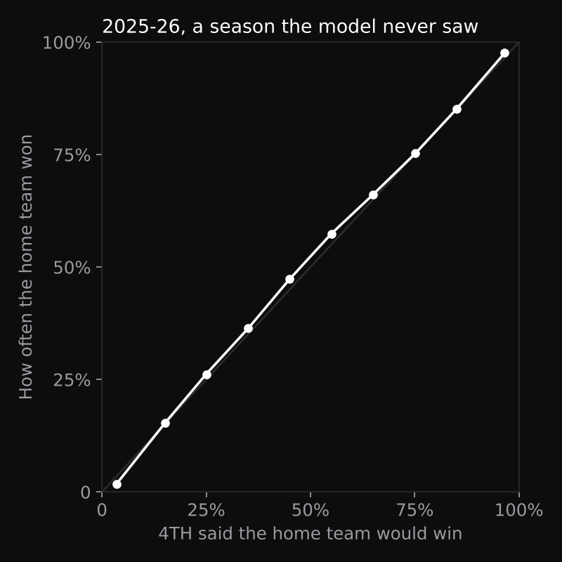

# 4TH

**Live NBA scores, with each team's chance of winning updated play by play, every shot on a court, and the calls the referees got wrong.**



**[Open 4TH](https://milanpatel98.github.io/4th/)**. Works on a phone or a computer, with no sign-in and nothing to install.

- **Tonight:** every game with live scores. Close games late in the 4th get an orange edge. Before tip-off, each card shows the chance of a close finish.
- **A game:** every shot on a full court, the win-chance line, and the plays that swung it. After the final, it also shows who closed the game, how dramatic it was, and the calls the NBA later ruled wrong, with what each one cost.
- **Season:** the games a wrong call may have decided, and the players who added the most wins in 4th quarters.

---

## Win chance

A small formula, trained on four seasons of NBA play-by-play (2021-22 to 2024-25, about 1.6 million game moments) and tested on all 1,230 games of 2025-26, a season it never saw.

```
chance home wins = logistic( a·(lead + 0.55·ball) / r  +  b·rating gap·r  +  c·r  +  d·overtime  +  e )
r = √(time left / 48 min)
```

- **The lead counts for more as time runs out**, which is why it is divided by r.
- **Who has the ball** moves the lead by 0.55 points either way: a 1.1-point swing, about what a possession is worth.
- **Team strength** (an Elo rating, updated every night from the scoreboard) matters early and fades as r shrinks.

| 2025-26, held out | Log loss (lower is better) | Brier |
| --- | --- | --- |
| **4TH** | **0.441** | **0.147** |
| Gradient-boosted trees (LightGBM, same inputs) | 0.442 | 0.148 |
| Score and time only | 0.480 | 0.163 |

- **The trees were tried and dropped.** They were no better, and the formula is five numbers that run instantly in the browser and draw a smooth line.
- **At halftime the side it favours wins 77% of the time.**
- **It is calibrated:** when it says 75%, the home team won 75% of the time.



**Close finish** (within 5 points with 2 minutes left) is predicted from the rating gap alone. It is honest but weak: every game lands between 15% and 36%, against a base rate of 29%, and it barely beats always guessing 29% (Brier 0.201 vs 0.205). Who wins is far easier to predict than how close it will be.

## Who closed it

Each play gets the change in win chance that the play itself caused: the chance after it, minus the chance with the old score and ball at the same moment. The clock running down is credited to no one.

- A made shot earns its points minus the possession it hands over.
- A miss loses the possession; the rebounder gets it back.
- Rebounds are centred on their average, so routine ones count for nothing.

"Most clutch" adds this up over every 4th quarter and overtime of 2025-26, in wins. Jamal Murray leads with +5.0.

## The calls the refs got wrong

For every game within 3 points in the last two minutes, the NBA publishes a **Last Two Minute report**: each call and non-call, reviewed on video and graded. 4TH reads the **incorrect calls** and **incorrect non-calls** and prices each one.

1. **Find the moment** in the play-by-play: the score, the clock and who had the ball.
2. **Estimate what the correct call was worth** to the team it hurt: 1.5 points for a shooting foul (two free throws), 1 point for a lost possession, 0.8 for other fouls.
3. **Price it:** the change in win chance if that team had those points.

A game counts as **flipped** when the wronged team lost by no more than the points the wrong calls cost it. That means the call *could* have decided it, not that it certainly did. There were **23 in 2025-26**, from 385 reports and 232 games with at least one wrong call. (2024-25: 14.)

## How the data stays live

- **Scores and plays:** ESPN's public scoreboard and game feed, read straight from your browser and refreshed every 10 seconds during live games, every 30 seconds when the tab is in the background. There is no server.
- **Win chance:** computed in your browser for every play, with the same formula used in training.
- **Every night**, a GitHub Action:
  - replays this season's results to update team ratings (`scripts/update_elo.py`);
  - reads any new Last Two Minute reports from the NBA and prices the wrong calls (`scripts/update_refs.py`);
  - then redeploys the site.
- **Team logos** load from the NBA's own servers.

## The model, rebuilt

```bash
# play-by-play from github.com/shufinskiy/nba_data (cdnnba_2020 … cdnnba_2025) into data/raw/
# referee reports from github.com/atlhawksfanatic/L2M (1-tidy/L2M/L2M_stats_nba.csv) into data/
pip install pandas pyarrow scikit-learn lightgbm
python model/states.py 2020 2021 2022 2023 2024 2025   # one row per play, with score, clock and ball
python model/model.py                                   # team ratings; the gradient-boosted comparison
python model/final.py                                   # the shipped formula, close finish, clutch, wrong calls
```

The results are in `model/results.json`.

## Run it

```bash
npm install
npm run dev
```

## Limitations

- **The formula knows the score, clock, ball and team strength, nothing else.** It doesn't know who is on the floor, fouls, timeouts or injuries.
- **The price of a wrong call is an estimate.** It uses average point values, not what actually followed the call. "Flipped" means could have decided the game, not did.
- **Referee reports only exist for close games**, and the NBA posts them a day or two later.
- **Win chance in older games** uses today's team ratings, not the ratings at the time.
- **The feeds are unofficial.** If ESPN or the NBA changes them, the app shows a "try again" message until it is updated.

## Credits

- **Live scores and plays:** ESPN.
- **Team logos and Last Two Minute reports:** the NBA.
- **Historical play-by-play:** [shufinskiy/nba_data](https://github.com/shufinskiy/nba_data).
- **2020-25 referee reports, tidied:** [atlhawksfanatic/L2M](https://github.com/atlhawksfanatic/L2M).

Unofficial fan project. Not affiliated with the NBA. Team names and logos belong to their teams.

© 2026 Milan Patel · MIT License
